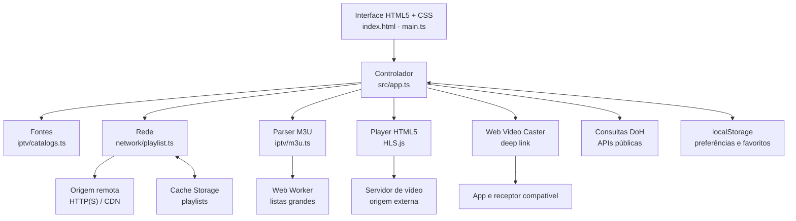

# ZentraCast


**IPTV e Smart Casting com uma experiência web minimalista.**

O **ZentraCast** é um player IPTV executado no navegador, com catálogos M3U/M3U8, reprodução HLS, pesquisa de canais, favoritos, diagnóstico DNS-over-HTTPS e integração com o **Web Video Caster**. O projeto usa HTML5, TypeScript, CSS3/Tailwind, HLS.js e Vite — sem backend próprio para transmitir vídeos.

**[Abrir aplicação](https://zplayer-alpha.vercel.app/)** · **[Repositório](https://github.com/jarodofc/ZentraCast)** · **[Guia visual](BRAND.md)**

---

## Índice

- [Visão geral](#visão-geral)
- [Funcionalidades](#funcionalidades)
- [Como usar](#como-usar)
- [Mapa do projeto](#mapa-do-projeto)
- [Arquitetura e fluxo](#arquitetura-e-fluxo)
- [Stack e requisitos](#stack-e-requisitos)
- [Instalação e scripts](#instalação-e-scripts)
- [Catálogos IPTV](#catálogos-iptv)
- [Web Video Caster](#web-video-caster)
- [Identidade visual](#identidade-visual)
- [Testes](#testes)
- [Deploy](#deploy)
- [Limitações e diagnóstico](#limitações-e-diagnóstico)
- [Contribuição e documentação](#contribuição-e-documentação)

## Visão geral

| Aspecto | Implementação |
| :-- | :-- |
| Plataforma | Aplicação web estática e responsiva |
| Idioma | Português (Brasil) |
| Interface | HTML5, CSS3, Tailwind CSS e SVG |
| Lógica | TypeScript, executado como JavaScript no navegador |
| Vídeo | HTML5 Video + HLS.js |
| Catálogos | Playlists públicas ou importadas em M3U/M3U8 |
| Transmissão | Deep link para o aplicativo Web Video Caster |
| Diagnóstico | APIs públicas DNS-over-HTTPS |
| Persistência | localStorage para preferências; Cache Storage para listas |
| Build | Vite → diretório `dist/` |
| Hospedagem | Vercel, sem backend próprio |

> **Princípio:** o ZentraCast organiza e abre endereços de vídeo. Os streams continuam hospedados nas respectivas origens; o aplicativo não os retransmite nem contorna proteções dessas origens.

## Funcionalidades

- **Catálogo unificado:** combinação de fontes, remoção de URLs duplicadas e carregamento parcial quando alguma fonte falha.
- **Importação M3U:** listas por URL HTTP(S) ou arquivo local, com exportação de playlists.
- **Pesquisa e navegação:** filtros por texto/categoria, favoritos e estado da conexão.
- **Reprodução:** HLS.js sob demanda, vídeo HTML5 e tratamento de erros de mídia/rede.
- **Cast:** envio de um canal para o Web Video Caster ou compartilhamento da URL.
- **Diagnóstico de rede:** consultas DoH, latência e auditoria de domínios.
- **Personalização:** tema claro/escuro, modo sólido e preferências locais.
- **Acessibilidade:** SVGs vetoriais, estados de foco e suporte a redução de movimento e transparência.

## Como usar

1. Entre na **[versão publicada](https://zplayer-alpha.vercel.app/)**.
2. Selecione **Tudo em um** ou escolha uma fonte IPTV individual.
3. Para listas próprias, utilize a importação por URL ou arquivo M3U/M3U8.
4. Clique em um canal para tentar reproduzi-lo pelo navegador.
5. No celular, use **Cast** para abrir o canal no Web Video Caster. Para várias entradas, use **Exportar M3U**.

A disponibilidade de canais depende de URLs ativas, CORS, autenticação, compatibilidade de mídia e conexão do dispositivo.

## Mapa do projeto

Estrutura de diretórios verificada na branch `main`:

```text
ZentraCast/
├── .gitignore                    # Arquivos ignorados pelo Git
├── BRAND.md                      # Manual de identidade visual
├── README.md                     # Documentação principal
├── index.html                    # HTML e pontos de montagem da UI
├── package.json                  # Dependências e comandos npm
├── postcss.config.js             # Processamento de CSS
├── tailwind.config.js            # Tema e configuração do Tailwind
├── tsconfig.json                 # Verificação TypeScript
├── vercel.json                   # Configuração de deploy
├── vite.config.ts                # Configuração do bundler
│
├── public/                       # Recursos estáticos
│   ├── favicon.svg               # Ícone do aplicativo
│   ├── manifest.webmanifest      # Metadados do web app
│   └── brand/
│       └── mark.svg              # Logo vetorial
│
├── src/
│   ├── main.ts                   # Entrada TypeScript + CSS
│   ├── app.ts                    # UI, estado e lógica existente
│   ├── types.ts                  # Interfaces de dados compartilhadas
│   ├── cast/
│   │   └── web-video-caster.ts   # Links de abertura no app WVC
│   ├── iptv/
│   │   ├── catalogs.ts           # Listas e mirrors configurados
│   │   ├── m3u.ts                # Leitura e exportação M3U
│   │   └── parse-worker.ts       # Orquestra o parser em Web Worker
│   ├── network/
│   │   └── playlist.ts           # Fetch, limites, failover e cache
│   ├── player/
│   │   └── hls-loader.ts         # HLS.js dinâmico e fallback de CDN
│   ├── styles/
│   │   └── app.css               # Tailwind + design system ZentraCast
│   └── workers/
│       └── m3u.worker.ts         # Processamento fora da thread principal
│
└── tests/
    └── iptv.test.mjs             # Testes automatizados de IPTV e rede
```

### Responsabilidade dos módulos

| Arquivo | Responsabilidade |
| :-- | :-- |
| [`src/app.ts`](src/app.ts) | Controla UI, reprodução, favoritos, DoH, eventos e estado |
| [`src/types.ts`](src/types.ts) | Define tipos para canais, cabeçalhos, fontes e resultados |
| [`src/iptv/catalogs.ts`](src/iptv/catalogs.ts) | Mantém catálogos IPTV e URLs CDN alternativas |
| [`src/iptv/m3u.ts`](src/iptv/m3u.ts) | Extrai metadados, grupos, URLs e serializa M3U |
| [`src/iptv/parse-worker.ts`](src/iptv/parse-worker.ts) | Seleciona parser direto ou Worker com fallback |
| [`src/workers/m3u.worker.ts`](src/workers/m3u.worker.ts) | Processa listas grandes em uma thread separada |
| [`src/network/playlist.ts`](src/network/playlist.ts) | Limita downloads, testa mirrors, cancela requests e usa cache |
| [`src/player/hls-loader.ts`](src/player/hls-loader.ts) | Carrega o HLS.js sob demanda |
| [`src/cast/web-video-caster.ts`](src/cast/web-video-caster.ts) | Constrói deep links de transmissão |
| [`src/styles/app.css`](src/styles/app.css) | Define temas, tokens, componentes e responsividade |

**Estado da refatoração:** `src/app.ts` permanece como controlador legado com `// @ts-nocheck`. Os módulos especializados utilizam TypeScript e as regras estritas do `tsconfig.json`. Isso permite evoluir a arquitetura sem reescrever a interface de uma vez.

## Arquitetura e fluxo



**Fluxo de dados:**

1. A interface recebe uma URL/arquivo ou a seleção de um catálogo.
2. A camada de rede faz downloads com timeout, verificação de conteúdo e fallback entre espelhos.
3. O parser extrai canais e metadados; listas maiores podem ser analisadas no Web Worker.
4. O controlador monta o catálogo filtrável e gerencia favoritos e reprodução.
5. O vídeo é solicitado à origem pelo player ou pela aplicação receptora no caso de Cast.

O diagnóstico DoH não substitui o resolvedor DNS do navegador e não interfere diretamente na rota de reprodução.

## Stack e requisitos

| Tecnologia | Função |
| :-- | :-- |
| HTML5 e CSS3 | Interface, layouts e player nativo |
| Tailwind CSS 3 + PostCSS | Estilos utilitários compilados |
| TypeScript 5 | Tipos e módulos de aplicação |
| Vite 8 | Dev server e build de produção |
| HLS.js 1.7.4 | Compatibilidade HLS quando suportada |
| Web Workers | Processamento de listas extensas |
| Fetch API / AbortController | Requisições e cancelamento |
| Cache Storage / localStorage | Cache de listas e configurações |
| SVG | Logo, favicon e ícones |
| Vercel | Publicação estática |

**Requisitos para desenvolver:** Node.js **22.12+**, npm e navegador moderno.

## Instalação e scripts

Clone o repositório e inicie o servidor:

```bash
git clone https://github.com/jarodofc/ZentraCast.git
cd ZentraCast
npm install
npm run dev
```

Abra no navegador a URL exibida pelo Vite. Para compilação e inspeção local:

```bash
npm run check
npm run build
npm run preview
```

| Script | Descrição |
| :-- | :-- |
| `npm run dev` | Inicia Vite para desenvolvimento |
| `npm test` | Executa testes com o test runner nativo do Node |
| `npm run typecheck` | Verifica tipos com `tsc --noEmit` |
| `npm run check` | Executa testes e verificação TypeScript |
| `npm run build` | Executa `check` e gera `dist/` |
| `npm run preview` | Pré-visualiza o build local |

O projeto deve ser servido por HTTP(S); não use `file://` para testar módulos e APIs do navegador.

## Catálogos IPTV

As fontes são definidas em [`src/iptv/catalogs.ts`](src/iptv/catalogs.ts):

| Fonte | Arquivo ou endpoint |
| :-- | :-- |
| Canais IPTV | `CanaisIPTV.m3u8` — Ramys |
| Filmes e Séries | `Filmes-Series.m3u8` — Ramys |
| Ramys Geral | `Canais.m3u8` |
| Brasil 01–04 | `CanaisBR01.m3u8` a `CanaisBR04.m3u8` |
| IPTV-org Brasil | `https://iptv-org.github.io/iptv/countries/br.m3u` |
| Free-TV Global | `https://raw.githubusercontent.com/Free-TV/IPTV/master/playlist.m3u8` |
| Tudo em um | Combinação dos catálogos acima, com deduplicação |
| Importações próprias | URL externa HTTP(S) ou arquivo M3U local |

Os catálogos Ramys possuem espelhos GitHub Raw e jsDelivr. O agregador utiliza até **3 fontes simultaneamente**, aceita resultados parciais e mantém até **30 mil URLs únicas** em memória. A importação de listas próprias participa da agregação durante a sessão.

O downloader impõe limite de **12 MiB por playlist**; a função de failover também pode reutilizar cópias previamente armazenadas em Cache Storage, quando disponível.

## Web Video Caster

O módulo [`src/cast/web-video-caster.ts`](src/cast/web-video-caster.ts) gera links no esquema `wvc-x-callback://open` com URL, título, capa, MIME HLS e, quando informados, determinados cabeçalhos da playlist.

- É necessário instalar o aplicativo Web Video Caster em um dispositivo compatível.
- O SO e o navegador devem aceitar a abertura do esquema externo.
- A reprodução final depende do receptor, codec, rede e condições do servidor de origem.
- **Exportar M3U** e **Compartilhar canal** são alternativas ao botão Cast.

Referência: [documentação de integração do Web Video Caster](https://www.webvideocaster.com/integrations).

## Identidade visual

**ZentraCast** utiliza visual minimalista, Liquid Glass discreto e ícones SVG. Arquivos de marca:

- [`public/brand/mark.svg`](public/brand/mark.svg) — logotipo vetorial;
- [`public/favicon.svg`](public/favicon.svg) — ícone de navegador;
- [`public/manifest.webmanifest`](public/manifest.webmanifest) — identidade do web app;
- [`BRAND.md`](BRAND.md) — guia de marca, tipografia e componentes.

| Elemento | Tema escuro | Tema claro |
| :-- | :-- | :-- |
| Fundo | `#0B111B` | `#F5F7FA` |
| Texto | `#F5F7FB` | `#152131` |
| Destaque | `#83AEFF` | `#355FCE` |

**Fontes:** Manrope (UI) e IBM Plex Mono (dados técnicos). Os estilos respeitam preferências de movimento e transparência reduzidos.

## Testes

O arquivo [`tests/iptv.test.mjs`](tests/iptv.test.mjs) cobre:

- interpretação de M3U, grupos, cabeçalhos e duplicatas;
- exportação de playlists;
- composição dos parâmetros de links do Web Video Caster;
- download com validação e limite de tamanho;
- uso de um espelho alternativo quando uma fonte falha.

```bash
npm test
npm run typecheck
npm run build
```

O comando `build` executa os testes e o typecheck antes de compilar. Isso **não comprova** funcionamento de todos os streams nem o pareamento com TVs reais; esses cenários precisam de testes manuais.

## Deploy

A configuração de [`vercel.json`](vercel.json) utiliza `vite`, `npm run build` e publicação de `dist/`.

1. Conecte o repositório à Vercel.
2. Use os parâmetros definidos em `vercel.json`.
3. Verifique a instalação das dependências e o resultado do build.
4. Teste a versão publicada no navegador e em dispositivo de cast.

O deploy serve arquivos estáticos: nenhum servidor Node.js permanece em execução em produção. O projeto define cabeçalhos de segurança para `X-Content-Type-Options`, `Referrer-Policy` e `Permissions-Policy`.

**Versão web:** [zplayer-alpha.vercel.app](https://zplayer-alpha.vercel.app/).

## Limitações e diagnóstico

| Situação | Verificação recomendada |
| :-- | :-- |
| Playlist não carrega | Fonte indisponível, timeout, URL incorreta ou CORS; tente outra lista ou arquivo local |
| Catálogo incompleto | Algumas fontes podem falhar e o carregamento continuará parcialmente |
| Canal não reproduz | Codec, autenticação, expiração de token, DRM, CORS, bloqueio regional ou origem offline |
| Cast não abre | Web Video Caster não instalado ou protocolo externo não permitido |
| Canal abre no celular, mas não na TV | Formato incompatível ou receptor sem acesso à URL |
| DNS responde, mas vídeo não | DoH não verifica disponibilidade ou permissão de mídia |
| Playlist não fica em cache | Contexto sem HTTPS ou armazenamento bloqueado pelo navegador |

**Restrições importantes:** o cliente não contorna CORS nem DRM; DNS-over-HTTPS não modifica as conexões do navegador; e cache de M3U não permite assistir a streams remotos offline. Use apenas listas e transmissões às quais você tem direito de acesso.

## Contribuição e documentação

- [Identidade visual — BRAND.md](BRAND.md)
- [Tipos compartilhados](src/types.ts)
- [Fontes de canais](src/iptv/catalogs.ts)
- [Testes automatizados](tests/iptv.test.mjs)
- [Issues do projeto](https://github.com/jarodofc/ZentraCast/issues)

Antes de propor uma alteração, prefira mudanças isoladas por módulo e execute `npm run check` e `npm run build`.

**Licença:** não há arquivo `LICENSE` no repositório atualmente; a publicação do código no GitHub, por si só, não concede uma licença de reutilização ou redistribuição.

---

**ZentraCast** · IPTV simplificado · [Abrir aplicação](https://zplayer-alpha.vercel.app/) · [GitHub](https://github.com/jarodofc/ZentraCast)
